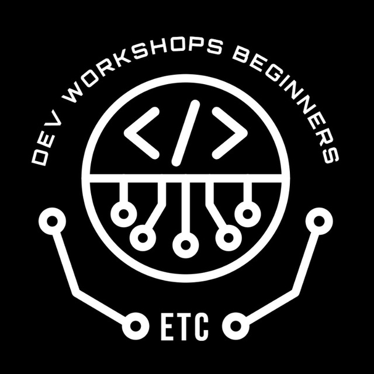

  

  # Dev Workshop Series: Building for the Web and Beyond
  **ENSIA Tech Community**

---

### What this workshop is about

Most tutorials teach you how to write HTML tags and style a button, but leave out how software actually works in the real world.

This series takes you through the entire engineering process: from your first lines of code to building full-stack web platforms, creating mobile apps, and deploying them to production servers.

We use Harvard's CS50W curriculum as our roadmap for the core web sessions, then extend it into mobile development, security, testing, and cloud infrastructure.

---

### What we cover

1. **Foundations & Collaboration**
   Semantic HTML, CSS layouts, Git, and team workflows.

2. **The Core Stack**
   Python for backend development, JavaScript for browser interactivity, Django framework, and SQL database modeling.

3. **Modern Interfaces**
   Component-based UIs and state management with React.

4. **Security & Scale**
   Authentication, session handling, preventing common vulnerabilities, and architecting for high traffic.

5. **Mobile Development**
   Taking web and backend concepts into native mobile environments, with guidance on preparing and publishing apps to the Play Store and App Store.

6. **Production & Operations**
   Automated testing, continuous integration and delivery (CI/CD), server configuration, and cloud deployment.

---

### Projects

Theory only matters when you apply it. Participants build six complete projects throughout the series:

- **Search:** Google-style front-end interface
- **Wiki:** Markdown-based encyclopedia platform
- **Commerce:** Online auction and bidding marketplace
- **Mail:** Single-page email client using APIs
- **Network:** Full-featured social network
- **Capstone:** An original, production-ready application designed and built from scratch

---

### Requirements

- A laptop (Windows, macOS, or Linux)
- A text editor (VS Code recommended)
- Curiosity about how things work under the hood

